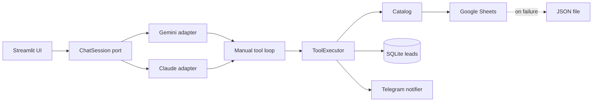

# Phone Store Assistant

A chat assistant for a phone store. It answers catalog questions from live data, detects real buying intent, saves a lead and pings a seller on Telegram. It runs on Gemini (free tier) or Claude behind one port.

> All catalog and lead data in this repo is fake.

## Problem

A phone store gets the same questions all day: "Do you have the X in 256 GB? How much?" Sellers spend time on repetitive answers, and hot leads get lost in the noise. The assistant answers from the real catalog (Google Sheets, with a JSON fallback) and, when a customer clearly wants to buy, hands the lead to a seller.

## Architecture



Ports and adapters: `CatalogRepository`, `LeadRepository`, `Notifier` and `ChatSession` are protocols. `app.py` is the only composition root.

## How the tool loop works

1. The adapter sends the conversation plus tool specs (`search_products`, `check_stock`, `create_lead`).
2. If the model asks for tools, the adapter runs each one through `ToolExecutor`, appends the results, and calls the model again.
3. When the model answers with plain text, the loop ends. A max-iteration cap (`MAX_TOOL_ITERATIONS`) stops runaway loops.

Design choices:

- **Manual loop**, not an SDK tool runner, so every step is visible and testable with fake clients.
- **Strict tools on Claude** (`strict: true`), so arguments match the schema.
- **Code-side validation** anyway: the executor re-validates every argument and never trusts the model.
- **Tools instead of stuffing the catalog in the prompt**: prices and stock are always read fresh, the prompt stays small and cacheable, and the catalog can grow without hitting context limits.

## Hallucination guards

- The system prompt tells the model to answer only from tool data.
- `create_lead` rejects unknown product ids, so a lead can never point at an invented phone.
- Tool errors are returned to the model as data; it is instructed to say the data is unavailable rather than guess.

## Failure modes

| Failure | Behavior |
| --- | --- |
| Google Sheets down or malformed | Falls back to the JSON catalog, logged |
| Sheets and JSON both down | Tool returns an error; the model says the catalog is unavailable |
| Telegram down or unset | Lead is kept in SQLite; result has `seller_notified: false` |
| LLM API error | Safe user-facing message (no traceback, no keys); history is rolled back so the conversation stays consistent |
| Missing API key | The UI shows a setup message instead of crashing |

## Setup and run (Windows PowerShell)

```powershell
cd phone-store-assistant
python -m venv .venv
.venv\Scripts\Activate.ps1
pip install -r requirements.txt
Copy-Item .env.example .env
# Edit .env: set GEMINI_API_KEY (free key at https://aistudio.google.com)
streamlit run app.py
python -m pytest        # no network or API key needed
```

Optional:

- **Google Sheets**: create a service account, download its JSON key, and share the sheet with the service-account email. Columns: `id, brand, model, storage_gb, price_ars, stock`. Set `GOOGLE_SERVICE_ACCOUNT_FILE` and `GOOGLE_SHEET_ID`.
- **Telegram**: create a bot with @BotFather, get your chat id, set `TELEGRAM_BOT_TOKEN` and `TELEGRAM_CHAT_ID`.
- **Claude**: set `LLM_PROVIDER=claude` and `ANTHROPIC_API_KEY`.

## Configuration

API keys (`GEMINI_API_KEY`/`GOOGLE_API_KEY`, `ANTHROPIC_API_KEY`) are read by the SDKs directly and never pass through app objects.

| Variable | Default | Purpose |
| --- | --- | --- |
| `LLM_PROVIDER` | `gemini` | `gemini` or `claude` |
| `GEMINI_MODEL` | `gemini-3.8-flash` | Gemini model |
| `GEMINI_FALLBACK_MODEL` | `gemini-2.5-flash` | Used when the primary model returns 503 (overloaded) or 429 (rate limited) |
| `CLAUDE_MODEL` | `claude-opus-5-5` | Claude model (`claude-haiku-5-5` is cheaper) |
| `CLAUDE_EFFORT` | `medium` | `low`, `medium` or `high` |
| `MAX_TOOL_ITERATIONS` | `6` | Max model calls per user message |
| `GOOGLE_SERVICE_ACCOUNT_FILE` | unset | Service-account JSON path |
| `GOOGLE_SHEET_ID` | unset | Spreadsheet id |
| `GOOGLE_SHEET_WORKSHEET` | `catalog` | Worksheet name |
| `TELEGRAM_BOT_TOKEN` | unset | Bot token (unset: notifications are logged only) |
| `TELEGRAM_CHAT_ID` | unset | Seller chat id |
| `LEADS_DB_PATH` | `leads.db` | SQLite file |
| `CATALOG_JSON_PATH` | `data/catalog.json` | JSON fallback catalog |

## Cost

- **Gemini**: free tier; limits vary per project, check AI Studio.
- **Claude** (estimates, not measurements): a 6-message conversation, assuming about 54k input and 3k output tokens in total, costs roughly USD 0.007 on `claude-haiku-5-5` ($0.10 / $0.50 per MTok in/out) and USD 0.28 on `claude-opus-5-5` ($4 / $20 per MTok), before caching.
- **Levers**: prompt caching on the stable prefix (tools + system), a cheaper model, lower effort, fewer tool round-trips, cached catalog reads.

## Possible improvements

- Cache catalog reads (today: one Sheets read per tool call).
- Stream replies.
- OpenAI-compatible adapter (covers GPT, DeepSeek and others).
- Evals for lead-detection precision.
- Authentication for the seller view (the "Recent leads" panel is open; fine for fake data).
- Verify Gemini's handling of `minimum` in tool schemas.
